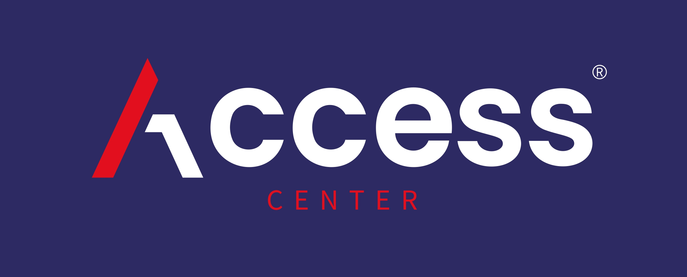

<div align="center">



# ACCESS CENTER

**Centre de formation et de services numériques — Loudaya, Marrakech**

Site vitrine, catalogue de formations, services en ligne, comptes utilisateurs,
cours en ligne protégés et panneau d'administration.

🌐 **Site en production : [https://accesscenter.ma](https://accesscenter.ma)**


</div>

---

## À propos

**ACCESS CENTER** est un centre de formation fondé en **2024** à Loudaya, près de
Marrakech. Il propose des formations présentielles et en ligne, ainsi que des
services numériques et créatifs pour les particuliers et les professionnels.

- 🎓 **14 formations** : 3D, Cuisine & Pâtisserie, Photographie, Infographie /
  Design Graphique, Montage Vidéo, Marketing Digital, Développement Web,
  Électricité Bâtiment, Énergie Solaire, Alarme & Caméras, Comptabilité,
  Informatique Bureautique, Intelligence Artificielle, Éducation & Pédagogie
- 🛠️ **15 services** : photos d'identité, impression, shooting, logo, design,
  montage vidéo, création de site web, réseaux sociaux, Meta Ads, podcast,
  réparation informatique, installation de logiciels, CV, cartes de visite,
  traduction
- 👥 **+500 élèves** formés, **98 % de satisfaction** (chiffres affichés sur le site)
- 🕘 Ouvert du lundi au samedi, de 09:00 à 19:00
- 📍 Loudaya, Marrakech — 📞 +212 762-934592 — ✉️ contact@accesscenter.ma

## Fonctionnalités

| Domaine | Détails |
| --- | --- |
| **Site vitrine** | Accueil, formations, services, à propos, contact, WhatsApp flottant |
| **Catalogue** | 14 formations et 15 services, fiches détaillées, recherche et filtres |
| **Cours en ligne** | Cours vidéo protégés (accès réservé aux inscrits), lecteur intégré, aperçu gratuit |
| **Comptes utilisateurs** | Inscription, connexion, vérification par e-mail, réinitialisation du mot de passe |
| **Administration** | Panneau admin : gestion du catalogue, des cours en ligne et des utilisateurs |
| **Multilingue** | Français, Arabe et Anglais (FR / AR / EN) |
| **Responsive** | Interface adaptée mobile, tablette et ordinateur |

## Stack technique

| Couche | Technologies |
| --- | --- |
| **Frontend** | React 18, Vite 6, Tailwind CSS 3, React Router 7, Lucide Icons |
| **Backend** | Node.js, Express 5, MySQL (`mysql2`) |
| **Authentification** | Sessions par cookie HttpOnly, bcrypt, vérification par e-mail (Nodemailer) |
| **Sécurité** | Helmet, CORS, protection CSRF, limitation de débit (`express-rate-limit`) |
| **Base de données** | MySQL 8 — migrations et seeds en SQL / Node.js |

## Démarrage rapide

### Prérequis

- **Node.js 20+** et npm
- **MySQL 8** (local ou distant)

### Installation

```bash
# 1. Cloner le projet
git clone https://github.com/Abdennacer-Bousadra/access-center.git
cd access-center

# 2. Installer les dépendances
npm install

# 3. Configurer l'environnement
cp .env.example .env
# → remplir les variables : base de données, SMTP, SESSION_SECRET
```

### Base de données

```bash
npm run db:migrate          # crée les tables
npm run db:seed             # données de démonstration
npm run db:seed:informatique # seed du catalogue informatique
npm run create-admin        # crée un compte administrateur
```

### Lancement (deux terminaux)

```bash
# Terminal 1 — frontend Vite
npm run dev                 # http://localhost:5173

# Terminal 2 — API Express
npm run server              # http://localhost:5000
# (ou : npm run dev:server pour le rechargement automatique)
```

Autres scripts : `npm run build` (build de production), `npm run preview`
(aperçu du build).

## Variables d'environnement

| Variable | Description | Exemple |
| --- | --- | --- |
| `PORT` | Port de l'API Express | `5000` |
| `CLIENT_ORIGIN` / `APP_URL` | URL du frontend (CORS) | `http://localhost:5173` |
| `SESSION_SECRET` | Secret de session (48+ octets aléatoires) | — |
| `BCRYPT_ROUNDS` | Coût du hachage des mots de passe | `12` |
| `SMTP_HOST`, `SMTP_PORT`, `SMTP_USER`, `SMTP_PASS` | Serveur d'envoi des e-mails | — |
| `MAIL_FROM` | Expéditeur des e-mails | `contact@accesscenter.ma` |
| `DB_HOST`, `DB_PORT`, `DB_USER`, `DB_PASSWORD`, `DB_NAME` | Connexion MySQL | `accesscenter` |
| `VIDEO_DIR` | Dossier des vidéos privées des cours | `./storage/videos` |

> ⚠️ **Ne jamais commiter le fichier `.env`.** Il contient des secrets
> (base de données, SMTP, secret de session). En production, placez
> `VIDEO_DIR` **en dehors de `public_html`** pour que les vidéos restent
> inaccessibles directement.

## Structure du projet

```
access-center/
├── src/                  # Application React
│   ├── pages/            # Pages : Accueil, Formations, Services, Cours en ligne,
│   │   │                 #   Connexion, Vérification e-mail, Admin…
│   │   └── admin/        # Pages du panneau d'administration
│   ├── components/       # Composants réutilisables (Header, Footer, cartes…)
│   ├── context/          # Contextes React (authentification, langue)
│   ├── i18n/             # Traductions FR / AR / EN
│   ├── data/             # Contenu du catalogue (formations, services)
│   ├── hooks/            # Hooks personnalisés
│   └── assets/           # Logo, images, bannières
├── server/               # API Express
│   ├── routes/           # auth, catalog, onlineCourses, me, csrf, admin
│   ├── middleware/       # requireAuth, requireAdmin, csrf, rateLimit
│   ├── db/               # schema.sql, migrations, seeds, create-admin
│   └── lib/              # Utilitaires serveur
├── public/               # Fichiers statiques
└── .env.example          # Modèle des variables d'environnement
```

## API — aperçu

| Route | Description |
| --- | --- |
| `POST /api/auth/register` · `POST /api/auth/login` · `POST /api/auth/logout` | Inscription, connexion, déconnexion |
| `GET /api/auth/verify-email` · `POST /api/auth/forgot-password` | Vérification e-mail, mot de passe oublié |
| `GET /api/catalog/...` | Catalogue des formations et services |
| `GET /api/online-courses/...` | Cours en ligne (aperçu public / contenu protégé) |
| `GET /api/me` | Profil de l'utilisateur connecté |
| `GET /api/csrf-token` | Jeton CSRF pour les requêtes protégées |
| `/api/admin/...` | Routes réservées aux administrateurs |

Toutes les routes sensibles exigent une session valide ; les routes admin
exigent en plus le rôle administrateur.

## Sécurité

- Mots de passe hachés avec **bcrypt** (12 rounds)
- Sessions par **cookie HttpOnly** (non accessible en JavaScript)
- Vérification de l'adresse e-mail à l'inscription
- Protection **CSRF** sur les requêtes sensibles
- **Limitation de débit** sur l'authentification et l'API
- En-têtes sécurisés via **Helmet** et CORS restreint à `CLIENT_ORIGIN`
- Fichiers vidéo servis uniquement via l'API, jamais en accès direct

## Déploiement

Le site est hébergé chez **Namecheap** (https://accesscenter.ma).
En production : construire le frontend (`npm run build`), servir le dossier
`dist/` en statique, lancer l'API avec `NODE_ENV=production`, et configurer
les variables d'environnement côté serveur (jamais dans le code).

---

## Contact

- 🌐 Site : [https://accesscenter.ma](https://accesscenter.ma)
- ✉️ E-mail : contact@accesscenter.ma
- 📞 Téléphone : +212 762-934592
- 📍 Loudaya, Marrakech, Maroc

*Projet privé — © ACCESS CENTER, tous droits réservés.*
